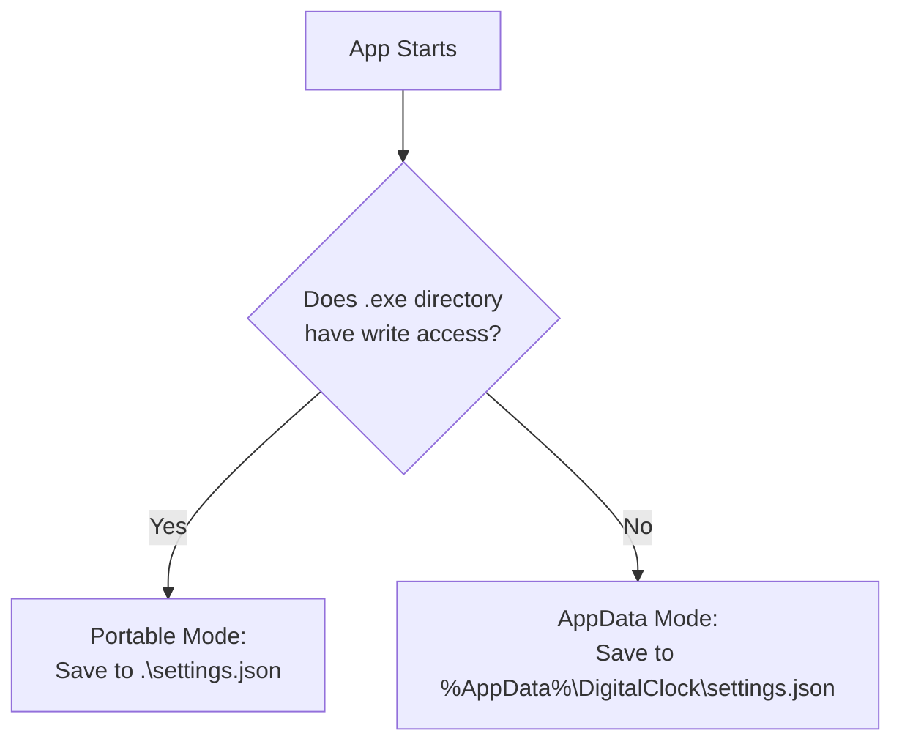
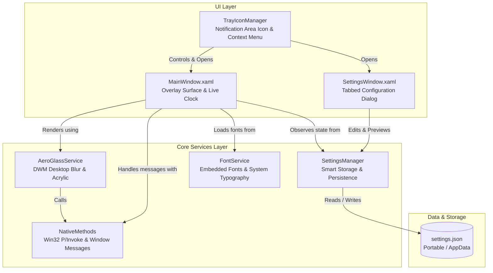

# DigitalClock

A modern, highly customizable desktop clock application built with **.NET 10** and **WPF**.


[](https://microsoft.com/windows)
[](https://dotnet.microsoft.com/)
[](https://docs.microsoft.com/dotnet/csharp/)
[](LICENSE.txt)
[](CHANGELOG.md)

---

## Table of Contents

- [✨ Features](#-features)
- [📖 User Documentation](#-user-documentation)
  - [Getting Started & Installation](#getting-started--installation)
  - [Direct Window Interaction](#direct-window-interaction)
  - [Interactive Resizing & Screen Fit](#interactive-resizing--screen-fit)
  - [Click-Through (Ghost Mode)](#click-through-ghost-mode)
  - [Position Snapping](#position-snapping)
  - [System Tray (Notification Area) Controls](#system-tray-notification-area-controls)
  - [Settings Dialog Tour](#settings-dialog-tour)
    - [General Settings](#general-settings)
    - [Appearance Settings](#appearance-settings)
    - [Behavior & Snapping](#behavior--snapping)
    - [About & Reset](#about--reset)
  - [Configuration Storage Modes](#configuration-storage-modes)
- [💻 Developer Documentation](#-developer-documentation)
  - [Architecture & Tech Stack](#architecture--tech-stack)
  - [Project Directory Map](#project-directory-map)
  - [Core Services & Subsystems](#core-services--subsystems)
  - [Win32 P/Invoke & DWM Backdrop Integration](#win32-pinvoke--dwm-backdrop-integration)
  - [Building from Source](#building-from-source)
  - [Publishing Standalone Executables](#publishing-standalone-executables)
  - [Contributing Guidelines](#contributing-guidelines)
- [📜 License](#-license)

---

## ✨ Features

* **Windows Aero Glass & Backplates**: Native DWM desktop blur-behind with specular borders, Dark/Light frosted rounded pills, and 100% transparent floating text.
* **Curated & System Typography**: Embedded **Digital 7-Segment (DSEG7)** LCD clock font + dynamic loading of every installed Windows font (Segoe UI, Bahnschrift, Consolas, Cascadia Code, etc.).
* **Dynamic Colors & Themes**: Automatic synchronization with your **Windows Accent Color**, vibrant quick-preset palette, and full Hex/RGB custom color picker.
* **Interactive 8-Direction Resizing**: Resize smoothly by dragging any border or corner with custom directional cursors.
* **Smart Screen Fit & Position Persistence**: Automatically sizes from border-to-border on first run, saves exact coordinates and dimensions across restarts, and supports one-click size reset.
* **Click-Through (Ghost) Mode**: Allows mouse clicks to pass completely through to underlying desktop icons and applications.
* **Rich System Tray (Notification Area) Menu**: Fast access to clock visibility, Always on Top, Ghost mode, formatting, multi-monitor alignment, and settings.
* **Smart Portable & AppData Storage**: Self-contained `settings.json` alongside the executable in portable setups, with automatic `%AppData%` fallback when placed in write-protected paths (e.g. `Program Files`).
* **PerMonitorV2 DPI Aware**: Crystal-sharp vector graphics on multi-monitor setups with mixed DPI scaling (1080p, 1440p, 4K).

---

## 📖 User Documentation

### Getting Started & Installation

DigitalClock is 100% standalone and requires no traditional installer.

1. **Download / Build**: Obtain the `DigitalClock.exe` executable.
2. **Placement**: Place the file anywhere you like (e.g., `D:\Tools\DigitalClock` for Portable Mode, or `C:\Program Files\DigitalClock`).
3. **Launch**: Double-click `DigitalClock.exe` to run.
4. **Prerequisites**: Windows 10 (version 1809 or higher) or Windows 11 with [.NET 10 Runtime](https://dotnet.microsoft.com/) installed (or run the self-contained build).

---

### Direct Window Interaction

The clock window is designed for natural, fluid desktop usage:

| Interaction | Action | Description |
| :--- | :--- | :--- |
| **Move / Drag** | `Left-Click + Drag` | Click anywhere on the clock backplate or digits to move the window. |
| **Context Menu** | `Right-Click` | Opens the quick-action menu (Settings, Always on Top, Snapping, Lock, Hide, Exit). |
| **Minimize / Restore** | `Double-Click` | Hides the clock window into the system tray. Double-click the tray icon to restore. |
| **Resize** | `Hover Edge + Drag` | Hover over any window edge or corner to resize in 8 directions. |

---

### Interactive Resizing & Screen Fit

* **8-Direction Resizing**: Hover over the border edges or corners. The cursor will change to a sizing arrow (`↔`, `↕`, `⤢`, `⤡`) with a visual sizing cue. Click and drag to expand or shrink the clock.
* **Smart Initial Fit**: If launched for the first time without saved dimensions, the clock automatically scales border-to-border across the larger screen dimension (width on landscape, height on portrait) centered on the active display.
* **Reset Saved Size**: If you wish to restore dynamic screen fitting after resizing:
  * Select **Reset Size to Default** from the clock's right-click menu,
  * Or choose **Reset Size to Default** in the System Tray menu,
  * Or click **Reset Size to Default** under the **Behavior** tab in the Settings Dialog.

---

### Click-Through (Ghost Mode)

Click-Through Mode makes the clock transparent to mouse clicks:
* Clicks pass directly through the clock backplate and digits onto your desktop icons, shortcuts, or background windows.
* **How to Enable**: Check **Click-Through (Ghost Mode)** in the Settings Dialog or Context Menu.
* **How to Control / Disable**: When Click-Through is active, desktop clicks pass through the clock. To open Settings or disable Ghost Mode:
  1. Go to the **Windows Taskbar System Tray** (notification area).
  2. Right-click the **DigitalClock tray icon** (🕒).
  3. Uncheck **Ghost (Click-Through) Mode**, or select **Settings...**.

---

### Position Snapping

Quickly snap the clock to prominent desktop positions across single or multi-monitor setups:
* **Snap to Primary Screen**: Instantly centers the clock on your main display.
* **Snap Positions**:
  * Top-Left
  * Top-Right
  * Center
  * Bottom-Left
  * Bottom-Right
* Available from the clock right-click menu, the system tray menu, and the Settings Dialog.

---

### System Tray (Notification Area) Controls

DigitalClock runs unobtrusively in your system tray:
* **Left-Click / Double-Click**: Instantly toggles clock visibility (Show / Hide / Bring to Front).
* **Right-Click**: Displays the full management menu:
  * **DigitalClock Header**: Shows the live time preview.
  * **Settings...**: Launches the tabbed Settings Window.
  * **Show / Hide Clock**: Minimizes or restores the overlay.
  * **Always on Top**: Pin the clock above all standard desktop windows.
  * **Lock Position**: Prevent accidental dragging.
  * **Ghost (Click-Through) Mode**: Toggle click-through transparency.
  * **Time Format ▶**: Quick toggles for 12-Hour / 24-Hour mode and Show Seconds.
  * **Position & Monitor ▶**: Instant snap submenus (Center, Corners, Primary Screen, Secondary Screen).
  * **Start with Windows**: Toggle automatic startup on Windows login.
  * **Reset Size to Default**: Clear manual resize overrides.
  * **Exit DigitalClock**: Closes the application completely.

---

### Settings Dialog Tour

Access the Settings dialog by right-clicking the clock or tray icon and selecting **Settings...**.

```
┌────────────────────────────────────────────────────────┐
│ DigitalClock Settings                                  │
├─────────┬────────────┬──────────┬──────────────┬───────┤
│ General │ Appearance │ Behavior │ About & Reset│       │
└─────────┴────────────┴──────────┴──────────────┴───────┘
```

#### General Settings
* **Time Display Format**: Toggle between **12-Hour (AM/PM)** and **24-Hour** military time.
* **Show Seconds**: Display or hide live seconds (`HH:mm:ss` vs `HH:mm`).
* **Blink Colon**: Option to make the time separator `:` flash once every second.
* **Show Date**: Show or hide the secondary date line below the clock digits.
* **Date Format**: Choose from pre-configured standards:
  * `Full`: `dddd, MMMM d, yyyy` (e.g. *Sunday, October 18, 2026*)
  * `Long`: `MMMM d, yyyy` (e.g. *October 18, 2026*)
  * `Short`: `yyyy-MM-dd` (e.g. *2026-10-18*)
  * `Day & Date`: `ddd, MMM d` (e.g. *Sun, Oct 18*)
  * `Custom`: Enter any valid .NET custom DateTime format string.

#### Appearance Settings
* **Backdrop Style**:
  * **Windows Aero Glass**: Native DWM desktop blur-behind with specular glass outline.
  * **Dark Frosted Pill**: Rounded dark semi-translucent backplate card.
  * **Light Frosted Pill**: Rounded light semi-translucent backplate card.
  * **Transparent (None)**: Floating clock digits directly over your wallpaper.
* **Color Mode**:
  * **Windows Accent Color**: Automatically synchronizes with your current Windows theme accent.
  * **Color Presets**: One-click curated swatches (Pure White, Neon Cyan, Emerald, Amber, Violet, Coral, Sunset Orange).
  * **Custom Color**: Real-time Hex code input with live interactive color preview swatch.
* **Typography**:
  * **Bundled DSEG7**: Authentic 7-segment digital LED clock typeface.
  * **Bundled Technology**: A multisegmented font. Provides better looking Dates.
  * **System Fonts**: Automatically discovers and lists all installed Windows fonts (Segoe UI, Bahnschrift, Consolas, Cascadia Code, Arial, etc.).
* **Live Preview**: Every appearance change updates live on your desktop clock in real time before saving.

#### Behavior & Snapping
* **Always on Top**: Keeps the clock floating above all standard desktop applications.
* **Start with Windows**: Configures automatic startup via the user Windows Registry Run key.
* **Lock Position**: Disables mouse dragging to prevent moving the clock by accident.
* **Click-Through Mode**: Enables pass-through mouse clicks for unobstructed desktop navigation.
* **Notification Area Icon**: Toggle visibility of the system tray icon.
* **Reset Saved Window Size**: Clears manual sizing overrides and restores responsive screen-border fitting.

#### About & Reset
* **Application Information**: Displays application name and version details.
* **Configuration Storage Mode**: Shows whether the app is running in **Portable Mode** or **Standard AppData Mode**.
* **Configuration File Path**: Displays full path to `settings.json` with a convenient **Open Folder** button.
* **Factory Reset**: "Reset All Settings to Default" button to safely revert all configuration back to factory defaults.

---

### Configuration Storage Modes

DigitalClock automatically manages its configuration using an intelligent dual-mode engine:



1. **Portable Mode (Default when writable)**:
   * When running from a folder with write permissions (e.g., USB drive, user folder, `D:\Apps`), `settings.json` is stored right beside `DigitalClock.exe`.
   * You can copy the folder anywhere and retain your complete settings.
2. **Standard AppData Fallback**:
   * If running from a protected directory (such as `C:\Program Files` or a read-only share), DigitalClock automatically falls back to:
     `%AppData%\DigitalClock\settings.json`
3. **Legacy Migration**:
   * Automatically migrates legacy registry settings from older versions into modern JSON format on first launch.

---

## 💻 Developer Documentation

### Architecture & Tech Stack

DigitalClock is built on modern .NET technology with clean service abstraction and native Win32/DWM desktop composition integration:

* **Target Framework**: `.NET 10.0` (`net10.0-windows`)
* **UI Framework**: Windows Presentation Foundation (WPF) with SDK-style project system
* **P/Invoke & Interop**: Win32 User32 & Dwmapi (`SetWindowCompositionAttribute`, `DwmEnableBlurBehindWindow`, `GetWindowLongPtr`, `SetWindowLongPtr`)
* **NotifyIcon**: Windows Forms NotifyIcon bridged via clean WPF dispatching
* **Serialization**: `System.Text.Json` with source-generated schema models



---

### Project Directory Map

```
DigitalClock/
│
├── App.xaml / App.xaml.cs            # WPF Application entry point & single-instance lifecycle
├── MainWindow.xaml / .xaml.cs        # Primary clock overlay surface, 8-way resizing, Viewbox layout
├── SettingsWindow.xaml / .xaml.cs    # Modern tabbed configuration dialog with live preview
├── DigitalClock.csproj               # .NET 10 SDK project file (PerMonitorV2, Version, Metadata)
├── app.manifest                      # Win32 Application Manifest (DPI awareness, OS compatibility)
├── accessories-clock.ico             # High-resolution multi-size application icon
├── LICENSE.txt                       # MIT License file
├── CHANGELOG.md                      # Release changelog & version history
├── README.md                         # Project documentation
│
├── Helpers/
│   ├── AeroGlassService.cs           # Win32 DWM backdrop controller (Aero Glass, Acrylic, Frosted)
│   ├── AppSettings.cs                # POCO settings data contracts (General, Appearance, Behavior)
│   ├── ColorUtilities.cs             # Color converters, hex parsers, and Windows Accent reader
│   ├── FontService.cs                # Embedded OpenType/TrueType loader & system font discovery
│   ├── NativeMethods.cs              # Win32 P/Invoke signatures, structs, and constants
│   ├── SettingsManager.cs            # Smart storage path resolver (Portable vs %AppData%)
│   ├── SnapPosition.cs               # Snap alignment enumeration (Corners, Center, Edges)
│   └── TrayIconManager.cs            # Notification area icon lifecycle & context menu builder
│
├── Resources/
│   └── Fonts/
│       └── *.ttf                     # Bundled digital clock typefaces (DSEG7, etc.)
│
└── Properties/
    └── AssemblyInfo.cs               # Theme resource dictionary attributes
```

---

### Core Services & Subsystems

#### 1. `AeroGlassService.cs` (DWM Desktop Blur Behind)
Applies hardware-accelerated Windows Desktop Window Manager (DWM) blur behind the clock backplate:
* Calls `SetWindowCompositionAttribute` with `AccentState.ACCENT_ENABLE_BLURBEHIND` and `ACCENT_ENABLE_ACRYLICBLURBEHIND`.
* Refreshes blur sampling on monitor drag or when Windows desktop wallpaper slideshow events (`WM_SETTINGCHANGE` / `WM_DISPLAYCHANGE`) occur.
* Uses native WPF rounded vector borders to eliminate rectangular translucent corners in Windows 11 24H2.

#### 2. `FontService.cs` (Typography Engine)
* **Embedded Fonts**: Loads curated typefaces via WPF pack URIs (`pack://application:,,,/Resources/Fonts/#FontName`).
* **System Fonts**: Enumerates `System.Windows.Media.Fonts.SystemFontFamilies`, filtering and alphabetizing installed system typefaces for real-time selection.

#### 3. `SettingsManager.cs` & `AppSettings.cs` (Storage Engine)
* Tests directory write permissions to decide between **Portable Mode** (beside executable) and **Standard Mode** (`%AppData%\DigitalClock\settings.json`).
* Implements deep cloning (`Clone()`) to support real-time non-destructive live preview in `SettingsWindow` with instant rollback on Cancel.

#### 4. `TrayIconManager.cs` (Notification Area Bridge)
* Wraps `System.Windows.Forms.NotifyIcon` with a sharp, high-resolution icon loaded from application pack resources.
* Re-creates the tray icon automatically upon Windows Explorer restart by registering the Win32 `TaskbarCreated` window message.

#### 5. `MainWindow.xaml.cs` (Responsive Layout & Window Management)
* **Fluid Viewbox**: Wraps time and date TextBlocks in a dynamic `<Viewbox>` to keep digits proportional and eliminate layout clipping.
* **8-Direction Edge Resizing**: Intercepts mouse coordinates around window borders, mapping cursor positions to 8-direction sizing logic with minimum size constraints.
* **OpenType Tabular Numerals**: Enforces tabular/monospaced digits to prevent horizontal jitter as digits tick from `1` to `8`.

---

### Win32 P/Invoke & DWM Backdrop Integration

The project interfaces with the Windows Desktop Window Manager and User32 subsystem through [NativeMethods.cs](file:///d:/Visual%20Studio/GitHub/DigitalClock/Helpers/NativeMethods.cs):

```csharp
[DllImport("user32.dll")]
internal static extern int SetWindowLong(IntPtr hWnd, int nIndex, int dwNewLong);

[DllImport("user32.dll")]
internal static extern int GetWindowLong(IntPtr hWnd, int nIndex);

[DllImport("user32.dll")]
internal static extern int SetWindowCompositionAttribute(IntPtr hwnd, ref WindowCompositionAttributeData data);

[DllImport("dwmapi.dll")]
internal static extern int DwmEnableBlurBehindWindow(IntPtr hWnd, ref DWM_BLURBEHIND pBlurBehind);
```

* **Click-Through Mode**: Toggles the `WS_EX_TRANSPARENT` extended window style.
* **Taskbar Recovery**: Uses `RegisterWindowMessage("TaskbarCreated")` to ensure the system tray icon survives Windows Explorer crashes or DWM resets.

---

### Building from Source

#### Prerequisites
* Windows 10 (1809+) or Windows 11
* [.NET 10 SDK](https://dotnet.microsoft.com/) (Version 10.0 or higher)
* Visual Studio 2026 / Visual Studio 2022 (v17.12+) or VS Code with C# Dev Kit

#### Build Commands
```pwsh
# Clone repository
git clone https://github.com/Only-Bimal/DigitalClock.git
cd DigitalClock

# Restore dependencies
dotnet restore

# Build Debug
dotnet build

# Build Release
dotnet build -c Release
```

---

### Publishing Standalone Executables

You can publish DigitalClock as a self-contained, single-file executable that runs on any compatible Windows PC without requiring .NET 10 to be installed:

```pwsh
# Publish self-contained, single-file 64-bit Windows executable
dotnet publish -c Release -r win-x64 --self-contained -p:PublishSingleFile=true -p:IncludeNativeLibrariesForSelfExtract=true
```

Output binary location:
`bin\Release\net10.0-windows\win-x64\publish\DigitalClock.exe`

---

### Automated Release Workflow & Packaging

Project includes both an automated **GitHub Actions CI/CD workflow** and a **local PowerShell automation script** to build, sign, package, and publish releases.

#### 1. Local Release Script (`build-release.ps1`)
To build, sign, and package a release locally on Windows:
```pwsh
# Build, sign (self-signed CN="Digital Clock (Bimal)"), package ZIP, and generate SHA-256 checksums
.\build-release.ps1

# Build and automatically tag and push to GitHub (triggers GitHub Actions release)
.\build-release.ps1 -CreateTag -PushTag

# Or sign with a custom PFX certificate
.\build-release.ps1 -CertPath "C:\path\to\cert.pfx" -CertPassword "password"
```

All release artifacts are generated in the `artifacts\` directory:
* `DigitalClock-v<version>-win-x64.zip` (ZIP containing `DigitalClock.exe` and `DigitalClock-PublicCert.cer`)
* `DigitalClock-PublicCert.cer` (standalone public certificate for optional user installation)
* `SHA256SUMS.txt` (SHA-256 verification hashes)

#### 2. GitHub Actions CI/CD Workflow (`.github/workflows/release.yml`)
The GitHub Actions workflow triggers automatically when a release tag is pushed:
```pwsh
git tag v2.6.0
git push origin v2.6.0
```
It can also be manually dispatched via the **Actions** tab in GitHub.

**Workflow Highlights:**
* **Size**: Packages a single-file binary.
* **Dual Signing Security**:
  * **Authenticode Signature**: Signed with RFC 3161 timestamping. If custom secrets (`WINDOWS_CERT_BASE64` and `WINDOWS_CERT_PASSWORD`) are configured in GitHub repository secrets, it uses your certificate; otherwise, it automatically creates a self-signed certificate.
  * **GitHub Artifact Attestation**: Attaches cryptographically verifiable Sigstore build provenance (`actions/attest-build-provenance`).
* **Automated GitHub Release**: Automatically parses `CHANGELOG.md` to extract the corresponding version notes and publishes the release assets.

#### 3. Verifying Authenticity & Trusting Self-Signed Certificates
* **Verify GitHub Build Provenance**:
  ```pwsh
  gh attestation verify DigitalClock-v2.6.0-win-x64.zip --owner Only-Bimal
  ```
* **Install Public Certificate (Optional)**:
  To eliminate the Windows SmartScreen unknown publisher prompt for self-signed builds, you can optionally install `DigitalClock-PublicCert.cer`:
  1. Double-click `DigitalClock-PublicCert.cer`.
  2. Click **Install Certificate...** &rarr; Select **Current User** (or Local Machine).
  3. Choose **Place all certificates in the following store** &rarr; **Browse...** &rarr; Select **Trusted Root Certification Authorities**.
  4. Complete the wizard. `DigitalClock.exe` will now be recognized as trusted on that PC.

---

### Contributing Guidelines

Contributions, bug reports, and suggestions are welcome!

1. **Fork the Repository**: Create your own feature branch (`git checkout -b feature/MyFeature`).
2. **Commit Changes**: Make sure code builds cleanly with zero warnings (`dotnet build -c Release`).
3. **Format & Document**: Maintain existing code style and naming conventions.
4. **Submit a Pull Request**: Provide a clear description of changes in your PR.

---

## 📜 License

This project is licensed under the [MIT License](LICENSE.txt).

```
Copyright (c) 2026 Bimal

Permission is hereby granted, free of charge, to any person obtaining a copy
of this software and associated documentation files (the "Software"), to deal
in the Software without restriction, including without limitation the rights
to use, copy, modify, merge, publish, distribute, sublicense, and/or sell
copies of the Software, and to permit persons to whom the Software is
furnished to do so, subject to the following conditions:

The above copyright notice and this permission notice shall be included in all
copies or substantial portions of the Software.
```